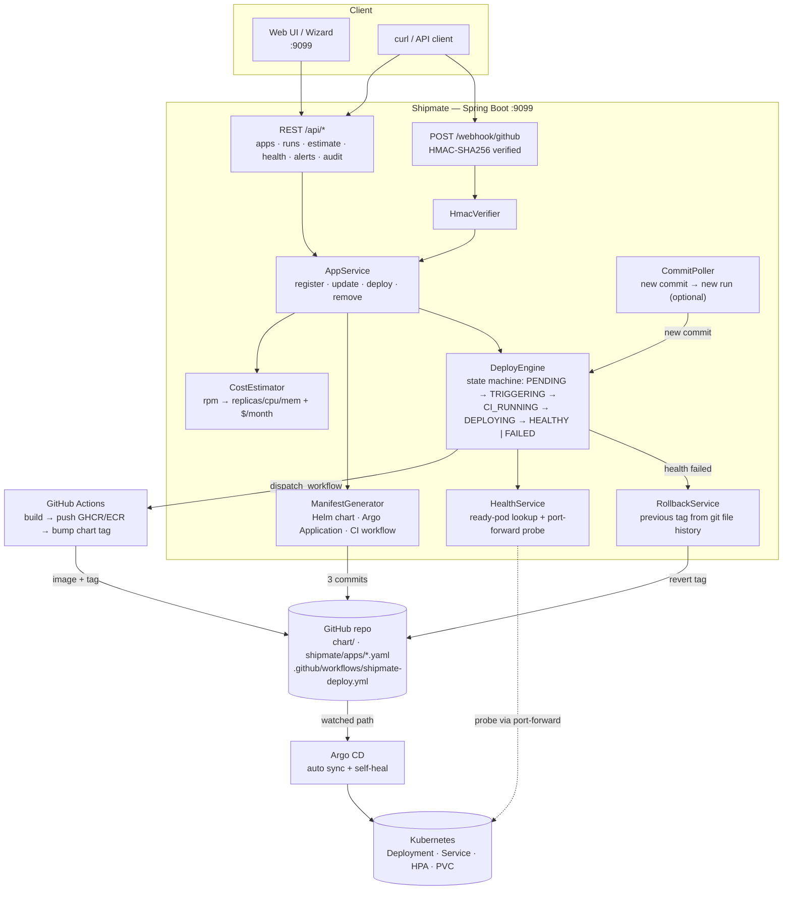

# ⚓ Shipmate — Self-Service Deploy Agent

A Spring Boot service that turns a Git repository URL into a running, health-verified,
auto-rollback-protected workload on Kubernetes.

You hand it a repo; it generates the Helm chart, the Argo CD `Application` and the CI
workflow, commits them back to your repo, triggers the pipeline, waits for CI, waits for
the rollout, probes health — and if health fails it reverts the image tag from git history
and tells you why.

```
POST /api/apps  →  estimate  →  deploy  →  CI  →  Argo CD sync  →  health probe  →  done (or auto-rollback)
```

---

## Architecture



### How a deploy actually runs

1. **Register** — `POST /api/apps` with a repo URL, expected `trafficRpm`, container port
   and health path. The agent parses owner/repo, derives `namespace = shipmate-<name>`,
   default health URL `http://<app>.<ns>.svc:port/actuator/health`, and defaults
   `dbEngine` to `postgres`.
2. **Estimate** — `CostEstimator.computeSizing(rpm)` → vCPU = `ceil(rpm/200)`,
   memory = vCPU GiB, replicas = `ceil(vcpu/2)`, then prices the instance class + database
   + fixed platform overhead (control plane, NAT, LB, registry) from a static price table.
   No AWS API call, so an estimate is instant and works without credentials.
3. **Deploy** — `ManifestGenerator` renders three artifacts and **commits them to the repo**
   (GitOps: the repo is the source of truth, the agent never keeps manifests to itself):
   - `chart/` — Helm chart (Deployment, Service, HPA, PVC, DB Deployment/Service)
   - `shipmate/apps/<name>.yaml` — Argo CD `Application`
   - `.github/workflows/<app>.yml` — CI workflow (GHCR or ECR, depending on `shipmate.registry.type`)
4. **Register with Argo CD** — the `Application` YAML is applied through the Kubernetes API
   (`K8sService.applyYaml`), so Argo CD starts managing the app without you touching kubectl.
5. **Trigger CI** — `DeployEngine` dispatches the workflow via the GitHub API and polls the
   run to completion (timeout: `pipeline.ci-timeout-min`).
6. **Wait for rollout** — polls `Deployment.status.readyReplicas` until the new pod is ready
   (`pipeline.deploy-timeout-min`).
7. **Verify health** — `HealthService` finds a *ready* pod, opens a **port-forward** to its
   container port and GETs the health path. Probing through a port-forward instead of a
   `LoadBalancer` URL means health checks work on clusters with no cloud LB (kind,
   bare-metal, `SHIPMATE_SERVICE_TYPE=NodePort`) and don't wait on DNS or LB provisioning.
8. **Rollback on failure** — if health never goes green: scan the commit history of
   `values.yaml` for the last **different** `tag:` line, rewrite it to the previous image
   tag, commit, and stop after `pipeline.max-rollbacks` attempts (no rollback loops).

A push webhook (`/webhook/github`) and a scheduled `CommitPoller` provide the same flow
when a commit lands instead of an explicit API call; bot commits (`shipmate:`, `chore: shipmate`,
`rollback:`, `[skip ci]`) are ignored so the agent can never trigger itself.

---

## Quick start

### Prerequisites

| Tool | Why |
|---|---|
| JDK 17+, Maven 3.9+ | build and run the agent |
| `kubectl` with a cluster context | deploy + health probes (kind works) |
| GitHub fine-grained PAT (`repo`, `actions`) or GitHub App key | commits + workflow dispatch |
| Argo CD in the target cluster | GitOps sync of generated charts |

### Run it

```bash
git clone https://github.com/Mojojojo0222/shipmate-agent.git
cd shipmate-agent

export GITHUB_TOKEN="YOUR_FINE_GRAINED_PAT"   # repo + actions scopes
export WEBHOOK_SECRET=$(openssl rand -hex 20)
# optional overrides
# export SHIPMATE_SERVICE_TYPE=NodePort      # no LoadBalancer needed (kind / local)
# export SHIPMATE_REGISTRY_TYPE=ecr          # default: ghcr

mvn spring-boot:run                          # → http://localhost:9099
```

Deploy the agent itself (optional):

```bash
kubectl create namespace shipmate
kubectl apply -f k8s/                        # namespace, SA, RBAC, config, secret, PVC, deployment
```

`k8s/secret.yaml` ships with placeholders — set `GITHUB_TOKEN`, `WEBHOOK_SECRET` and
`GITHUB_ACTIONS_ROLE_ARN` before applying. Pod probes hit `/actuator/health` on `:9099`,
resources are requests/limited, and state lives in a PVC-backed H2 file
(`jdbc:h2:file:/data/shipmate;MODE=PostgreSQL`).

### Deploy an app end-to-end

```bash
# 1. register
curl -X POST localhost:9099/api/apps -H 'Content-Type: application/json' -d '{
  "repoUrl": "https://github.com/Mojojojo0222/todoapp",
  "trafficRpm": 200,
  "trafficUsers": 50,
  "containerPort": 8080,
  "healthPath": "/actuator/health",
  "dbEngine": "postgres"
}'

# 2. cost estimate (no AWS credentials required)
curl -X POST localhost:9099/api/apps/1/estimate

# 3. change traffic profile later — sizing is recomputed on next deploy
curl -X PUT localhost:9099/api/apps/1 -H 'Content-Type: application/json' \
     -d '{"trafficRpm": 1000}'

# 4. deploy (commits chart + Argo app + workflow, then runs the pipeline)
curl -X POST localhost:9099/api/apps/1/deploy

# 5. watch it
curl localhost:9099/api/runs?appId=1
curl localhost:9099/api/health/latest
curl localhost:9099/api/audit
```

### Verify a webhook signature

```bash
SECRET=shipmate-webhook-secret
BODY='{"action":"opened"}'
SIG=$(printf '%s' "$BODY" | openssl dgst -sha256 -hmac "$SECRET" -r | cut -d' ' -f1)

curl -s -X POST localhost:9099/webhook/github \
  -H "Content-Type: application/json" \
  -H "X-GitHub-Event: push" \
  -H "X-Hub-Signature-256: sha256=$SIG" \
  -d "$BODY"
# expected HMAC: 80e07aa38c82681ea89732b5ca4335c2fd996ff9ab1e651284bb510d2cc77c8e
```

---

## API reference

Base URL `http://localhost:9099`

| Method | Path | Purpose |
|---|---|---|
| POST | `/api/apps` | register a repo (rpm, port, health path, db engine) |
| GET | `/api/apps` · `/api/apps/{id}` | list / fetch |
| PUT | `/api/apps/{id}` | update traffic profile or health path |
| DELETE | `/api/apps/{id}` | unregister |
| POST | `/api/apps/{id}/estimate` | cost + sizing, no AWS call |
| POST | `/api/apps/{id}/deploy` | generate → commit → CI → rollout → health |
| POST | `/api/apps/{id}/trigger` | re-run the pipeline for the current commit |
| GET | `/api/runs` · `/api/runs/{id}` · `/api/apps/{id}/runs` | pipeline state machine |
| GET | `/api/health/latest` | last probe per app |
| GET | `/api/alerts` · `/api/audit` | alert list and append-only audit trail |
| POST | `/webhook/github` | push events, HMAC verified |

Run states: `PENDING → TRIGGERING → CI_RUNNING → DEPLOYING → HEALTHY` (or `FAILED`, then
`ROLLING_BACK`). App states: `NEW → ESTIMATED → DEPLOYING → HEALTHY / DEGRADED / PAUSED`.

---

## Configuration

All keys live under `shipmate.*` in `src/main/resources/application.yml`
(env vars override them):

| Key | Default | Notes |
|---|---|---|
| `shipmate.github.token` | `${GITHUB_TOKEN:}` | PAT for commits + workflow dispatch |
| `shipmate.github.webhook-secret` | `${WEBHOOK_SECRET:changeme}` | HMAC secret, never commit a real one |
| `shipmate.github.ci-workflow` | `shipmate-deploy.yml` | workflow filename written per app |
| `shipmate.gitops.manifests-path` | `shipmate` | where Argo apps are committed |
| `shipmate.k8s.namespace-prefix` | `shipmate` | namespace = prefix + `-` + app name |
| `shipmate.k8s.service-type` | `${SHIPMATE_SERVICE_TYPE:LoadBalancer}` | `NodePort` for kind/local |
| `shipmate.registry.type` | `${SHIPMATE_REGISTRY_TYPE:ghcr}` | `ghcr` or `ecr` picks the CI template |
| `shipmate.pipeline.*` | 15m CI, 8m deploy, 6×10s health, 1 rollback | timeouts + safety limits |
| `shipmate.pricing.*` | ap-south-1 table | instance/db price list + platform overhead |

Secrets are read from the environment (`GITHUB_TOKEN`, `WEBHOOK_SECRET`,
`GITHUB_APP_PRIVATE_KEY`) — nothing sensitive is stored in the repo.

---

## Project structure

```
cloud-agent/
├── src/main/java/com/shipmate/
│   ├── controller/      ApiController · WebhookController · GlobalExceptionHandler
│   ├── service/         AppService (use cases) · DeployEngine (state machine)
│   │                    ManifestGenerator (chart/argo/CI templates)
│   │                    CostEstimator · HealthService · RollbackService
│   │                    CommitPoller · HealthMonitor · AuditService · SpecGenerator
│   ├── git/             GitHubClient (REST) · GitHubAuth (PAT + App JWT, BouncyCastle PEM)
│   ├── k8s/             K8sService (fabric8: apply, rollout, port-forward, endpoints)
│   ├── util/            HmacVerifier (X-Hub-Signature-256)
│   ├── model/           App · DeploymentRun · HealthRecord · AuditLog · Alert
│   ├── repository/      Spring Data JPA
│   └── config/          AgentProperties — one typed object for every shipmate.* key
├── src/main/resources/
│   ├── application.yml  config + price table
│   └── static/index.html  single-file ops UI (wizard + run monitor)
├── k8s/                 manifests to run Shipmate itself
├── Dockerfile           multi-stage (mvn → JRE)
└── pom.xml
```

---

## Design decisions

| Decision | Why | Trade-off |
|---|---|---|
| Manifests are committed to the app repo | GitOps audit trail; Argo CD has one source of truth; rollbacks are git reverts | agent needs write access to the repo |
| Health probe via **port-forward** | works without a cloud LoadBalancer; no DNS/LB wait; probes the pod that's actually serving | one TCP tunnel per check |
| Cost estimate from a **static price table** | instant, works offline and without AWS creds | prices need a periodic refresh |
| Rollback = **previous tag found in git history** | no local state needed; idempotent; survives agent restart | only as good as the file history |
| Argo `Application` applied via API | deploy works from a single `POST`; no manual kubectl step | Argo CD must already be installed |
| Single-thread executor + DB-claimed runs (`claim()` CAS) | safe to run more than one instance without double-deploying | one deploy at a time per node |
| State in file-backed H2 | zero-dependency start; PVC in k8s | not a HA datastore — swap for Postgres for multi-replica |

## Known limitations

- H2 file store → single-replica agent (the chart ships 1 replica on purpose).
- Static pricing table (ap-south-1) rather than live AWS Price List API.
- Generated charts assume an image pushed by the generated workflow; a repo without a
  `Dockerfile` fails validation at registration time.
- `dbEngine` selects the database template rendered into the chart (`postgres` default,
  `mysql` supported); RDS-backed databases are provisioned outside this agent.

## License

MIT — use it, fork it, build on it.
